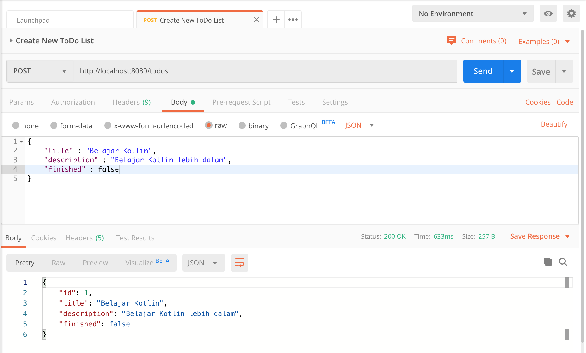
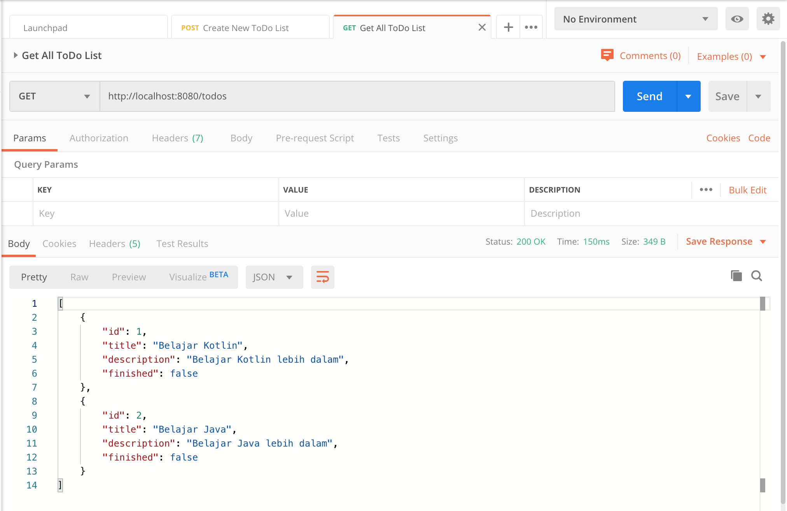
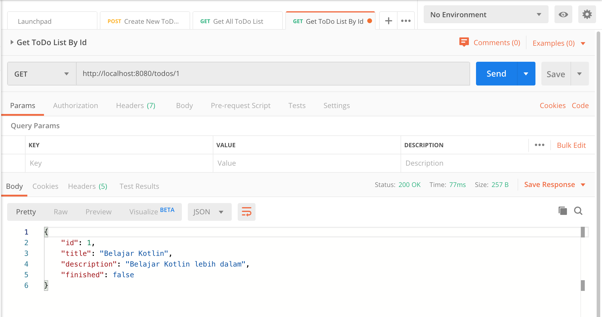
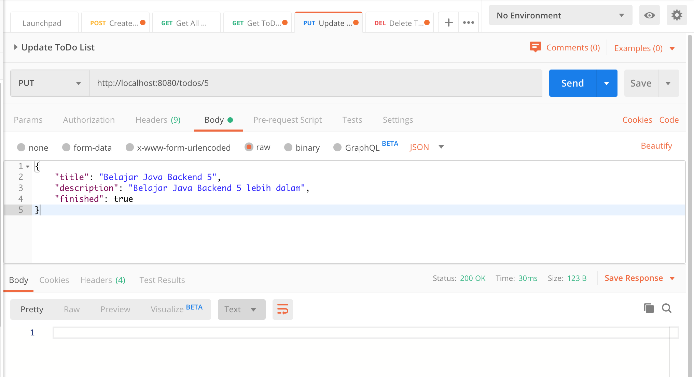
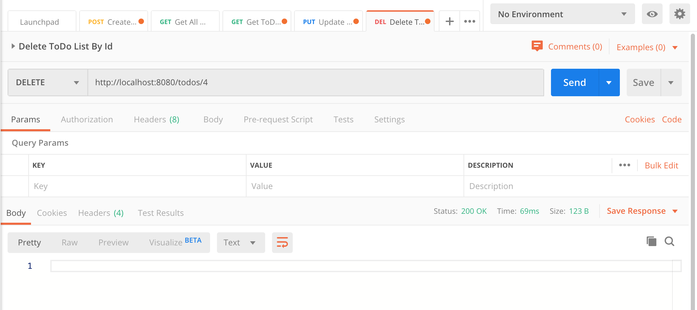

# Kotlin-ToDo-List-Rest-API

A simple ToDo List REST API built with Kotlin and Spring Boot.

## Tech Stack

- Java 25 (Gradle toolchain)
- Kotlin 2.4
- Spring Boot 4.1 (Web, Data JPA, Data REST)
- PostgreSQL + Flyway migrations
- Gradle 9 (wrapper included)
- Testcontainers 2 for integration tests

## Prerequisites

- JDK 25
- PostgreSQL running on `localhost:5432` with a database `hendisantika` (user `hendisantika`, password `root`).
  You can change these in `src/main/resources/application.properties`.
- Docker, to run the tests (Testcontainers starts a PostgreSQL container)

## Things to do list:
1. Clone this repository: `git clone https://github.com/hendisantika/Kotlin-ToDo-List-Rest-API.git`.
2. Go to your folder: `cd Kotlin-ToDo-List-Rest-API`.
3. Run the application: `./gradlew clean bootRun`
4. Open POSTMAN / Insomnia Application.

Flyway creates the `todo` schema and table automatically on startup.

To build and run the tests: `./gradlew clean build`

## Screen shot
**Add New ToDo List**

**Get All ToDo List**

**Get ToDo List By Id**

**Update ToDo List By Id**

**Delete ToDo List By Id**

Or you can import the POSTMAN Collection attached in this repository (`Kotlin ToDo List App.postman_collection.json`).
